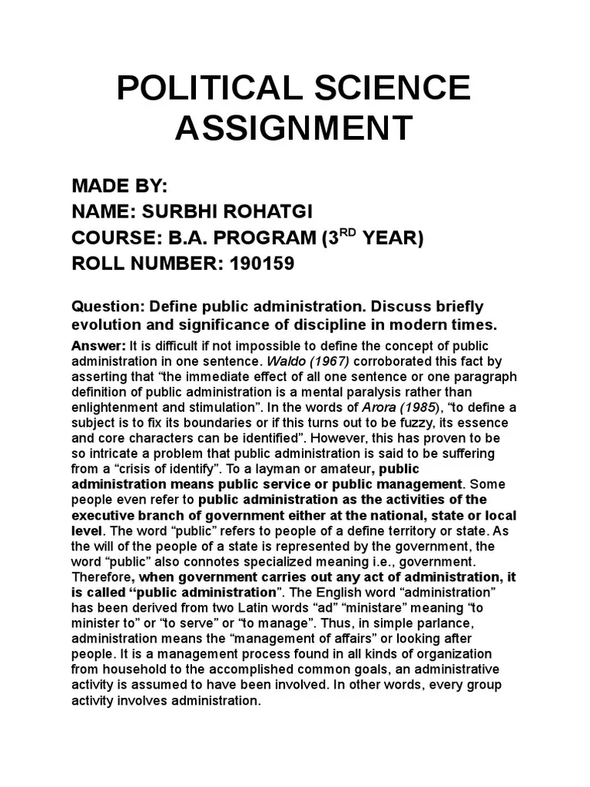

# What Makes a Higher Politics Assignment Standout: Tips & Tricks

## Prime Factors

The following are the ways that can help you write your higher politics assignment that can stand out from all others.

-   Take a moment to understand your assignment brief.
-   Choose an interesting topic for discussion.
-   Conduct thorough research to gather data from various perspectives.
-   Outline and plan the higher politics assignment structure.
-   Write a compelling research question.
-   You may ask for expert help if needed.

Keep reading if you want to learn about each key point in detail.

The subject of the highest politics grants an understanding of the significant political concepts and ideologies. Here, students study political systems through a comparative analysis that helps them evaluate political ideas, parties, and electoral performance. Understanding such systems, theories, and ideas can be challenging. It can take time to keep up with the changing political landscape.

This is where comprehending such concepts by writing various academic projects, such as a higher politics assignment, can assist in grasping concepts like decision-making, public policies, political behaviour, etc.

The assignment writing may enhance cognitive abilities and practical skills. While every student tries to achieve excellence in such projects, it can be difficult to compete. This is where making use of some expert tips in writing can fulfil your intent. The below is also meant for the same purpose. Read it thoroughly to come first in the lane.

## 6 Tips and Tricks to Write a Higher Politics Assignment That Stands Out

In the bustling realm of academics, there is a common question that lingers in the mind of the student: how do they make their higher politics assignments stand out among others? It is indeed a valid concern, especially when creativity is highly prized.

We have gathered some valuable insights to transform your project from ordinary to extraordinary. However, being susceptible to your performance, if you want to achieve excellence, then it is advisable to avail yourself of [assignment writing services UK](https://www.theacademicpapers.co.uk/assignment-writing-services/). These experts are well aware of the academic standards to boost your grades. Keep reading to know those expert tips.

### 1. Understand the Brief

Before you start the research and writing process, take a moment to understand the assignment briefly. Know the purpose of your assignment and the specific requirements. By grasping such essence, you can better tailor to the needs of the project.

Below are some key parameters that can help you in understanding your assignment.

-   Read the prompt thoroughly.
-   Understand the main tasks.
-   What should the word count be for the higher politics assignment?
-   Look for the details of the task.
-   Have a look at the higher politics assignment resource sheet.
-   Ask the tutor if you have any doubts.

### 2. Choose an Intriguing Topic

Although it is your tutor who has to assign you the topics, if you have the flexibility to choose, then go with the one that piques your interest. An interesting topic will not only keep you engaged but also reflect your enthusiasm in your work. The outcome is that you can write it engagingly for the reader and instructor.

### Higher Politics Assignment Topics

The SQA higher politics assignment can cover a wide range of topics, from analysis of political behaviour to the study of international relations. However, some of the good aspects that can be considered for your project may include,

-   Analyse the impact of the digital world on global politics.
-   Discuss the American political economy and culture.
-   What is the role of the military in democracy?
-   Discuss the role of religion in democracy.

### 3. Thorough Research is Key

Know that solid research is the cornerstone of writing a quality assignment. So, delve into a variety of sources to gather different perspectives. The more you study about your higher politics assignment topic, the better you can write about it. Goodreads provides a list of top books that can help you in writing your assignment.

-   The Communist Manifesto by Karl Marx.
-   The Republic by Plato.
-   Leviathan by Thomas Hobbes.
-   Why Nations Fail: The Origins of Power, Prosperity, and Poverty by Daron Acemoğlu.

### 4. Ask For Professional Help

Students are mostly assigned several academic writing tasks. It might involve assignments, essays, dissertations, etc. Working on such projects may require you to have excellent writing skills that many learners may lack. It may make them disappointed when they can't beat the increasing competition due to a lack of expertise. Hence, seeking [assignment writing help](https://yonkerstimes.com/no-1-best-assignment-writing-service-in-the-uk-for-2026-27-how-the-academic-papers-uk-is-gaining-students-trust/) from experts may not only assist you in completing academic tasks but also maintain your grades. These professionals are aware of the genera that can write it while abiding by the higher politics assignment marking scheme.

### 5. Craft a Captivating Thesis Statement

A thesis statement will bring up the main points of your assignment. Generally, it is written at the end of the introduction. For crafting a good thesis statement, engage time in,

-   Testing your higher politics assignment ideas to distillate them into one or two sentences.
-   Develop your arguments.
-   Figure out how to provide the reader with a guide to your arguments.

### Higher Politics Assignment Research Questions

Much of the research in the field of higher politics speaks about how society should be set up and what the ethics are. Here are the practical topics to explore for future studies.

-   What is the effect of economic sanction as a foreign policy tool?
-   How does software power shape international public opinion?
-   Analyse the US-China relationship in the context of global power shifts.

### 6. Outline and Structure

In any academic project, structure is essential for the better organisation of the ideas. An organised write-up may allow the reader to follow your arguments while navigating through the context effectively. So, a clear structure is imperative to the cohesive write-up. Griffith University provides a layout of the assignment structure that you must consider before starting your assignment writing process.

_Assignment structure diagram showing the introduction, body paragraphs and conclusion._

Moreover, if you can comprehend how to frame your ideas in this template, then it is better to look at the sample.

### Higher Politics Assignment Examples

Looking at previously written samples will help you better comprehend assignment writing. You may get an idea about details such as formatting, tone, length of the project, etc. Scribd presents a similar example, which can be helpful material for you.

_Example of a political science assignment page._

## Conclusion

If you are stuck with writing your higher politics assignment, the above guide is worthy of consideration. Here, we have discussed the top tips that can grant specificity to your work. It may include understanding your assignment prompt, choosing an intriguing topic, conducting thorough research, planning the structure, etc.

All of these crucial factors may contribute to the quality of your work and assist in making it unique among all others. However, be mindful of your previous academic progress. If you can’t take any risk at this turn, then [buy assignment online](https://www.affordable-dissertation.co.uk/buy-assignment-online/) from professionals. These experts may also help you achieve the desired outcomes.
